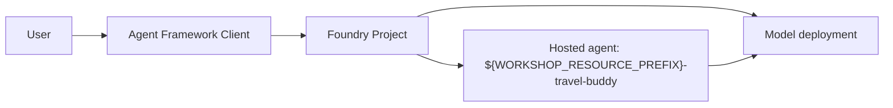

# Step 1 — Your first hosted agent: TravelBuddy

> **Goal:** stand up a hosted Foundry agent that can hold a basic travel conversation.

## What you'll learn

- What a Foundry **hosted agent** is and how the Agent Framework talks to it
- How `DefaultAzureCredential` flows from `az login` to the agent client
- The single `azure.yaml` file that tells the Azure Developer CLI (`azd`) how to run, provision, and deploy your agent

## What's already in the repo

- `travel_assistant/requirements.txt` — the Python packages for the Step 1 agent.
- `azure.yaml` (at the **repo root**, next to `travel_assistant/`) — the azd project file that describes your hosted agent: its name, protocol, container, CPU/memory, and environment variables. You'll read it and make one edit: your agent's name.
- `travel_assistant/main.py` — the Python entry point. You'll write TravelBuddy's instructions.
- `travel_assistant/Dockerfile` — how your agent is packaged into the container image Foundry runs. Provided complete; you'll read it.
- `travel_assistant/.dockerignore` — keeps build junk and local secrets (`.env`) out of that image.
- `travel_assistant/.azdignore` — tells `azd` which files *not* to upload when it packages the deployment.

In this step you **complete** two small edits called out below (your agent's name in `azure.yaml` and TravelBuddy's instructions in `main.py`) — you don't create the files from scratch. The workshop is **incremental**: when you advance, the next step's files are laid on top of your `travel_assistant/` folder. Files from earlier steps that the next step doesn't touch stay exactly as they are — nothing is deleted. Files the next step ships (for example an updated `main.py`) are refreshed to that step's version, and your current work is backed up under `.workshop_instance/workshop_backups/step-<N>/` first, so you can always recover your own wording.

> **Before you start:** make sure you completed the setup in Step 0 — [Install the tools you'll need](.workshop/docs/steps/00-intro.md#install-the-tools-youll-need) and [Set up your local environment](.workshop/docs/steps/00-intro.md#set-up-your-local-environment-one-time). If `python .workshop/scripts/preflight.py --step 1` is green, you're ready.

## Concept (5-min read)

**Azure AI Foundry** (the Learn docs now call the new experience **Microsoft Foundry**) is the Azure platform for building, deploying, and managing AI apps and agents. It gives you a portal, SDKs, model catalog, model deployments, agent tooling, tracing, evaluation, and access controls in one place, instead of making every app assemble those pieces by hand.

A **Foundry project** is the workspace boundary for one app, prototype, or team. It holds the things your code needs at runtime: model deployments, connections, files, evaluations, and hosted agents. The `AZURE_AI_PROJECT_ENDPOINT` value in your `.env` points to exactly one project, usually in this shape:

```text
https://<foundry-resource>.services.ai.azure.com/api/projects/<project-name>
```

In this workshop, TravelBuddy uses that endpoint plus `AZURE_AI_MODEL_DEPLOYMENT_NAME` to find the model deployment inside your project.

A **raw model call** sends a prompt directly to a model deployment and gets one response back. That is useful, but the caller must know all of the app wiring: which model to use, what instructions to send, how to manage conversation state, where tools live, and how to deploy the code.

A **Foundry hosted agent** is different: it is an agent application packaged as a **container image** and deployed **into your Foundry project**, where Foundry runs it for you as a managed service. The package tells Foundry how to start the agent, which protocol it serves, which environment variables it needs, and what resources it should get. In Step 1 the agent only chats; in later steps the same hosted boundary becomes the place where TravelBuddy gains tools, retrieval, workflows, and memory.

The **Microsoft Agent Framework** is the Python/.NET SDK we use to build the agent in code. Here, `FoundryChatClient` connects to your Foundry project and model deployment, `Agent` defines TravelBuddy's name and instructions, and `ResponsesHostServer` exposes the agent through the Responses protocol. `DefaultAzureCredential` reuses the Azure sign-in you created with `az login`.

These files are the smallest hosted-agent package:

- `azure.yaml` (repo root) is the **one** configuration file for the [Azure Developer CLI](https://learn.microsoft.com/azure/developer/azure-developer-cli/overview) (`azd`) and its Foundry extensions. It declares the Foundry project you deploy into and the hosted agent itself; `azd ai agent run`, `azd provision`, and `azd deploy` all read it.
- `main.py` is ordinary Python code, so you can run the same agent locally before deploying it.
- `Dockerfile` and `.dockerignore` package `main.py` and its dependencies into the container image Foundry runs.
- `.azdignore` keeps files the running agent doesn't need (such as `.env.example`) out of that deployment upload.



Helpful references:

- [What is Microsoft Foundry?](https://learn.microsoft.com/azure/ai-foundry/what-is-azure-ai-foundry)
- [Create a project for Microsoft Foundry](https://learn.microsoft.com/azure/ai-foundry/how-to/create-projects)
- [What are hosted agents?](https://learn.microsoft.com/azure/foundry/agents/concepts/hosted-agents)
- [azure.yaml reference for hosted agents](https://learn.microsoft.com/azure/foundry/agents/concepts/azure-yaml-reference)
- [Install the Azure Developer CLI Foundry extensions](https://learn.microsoft.com/azure/foundry/agents/how-to/install-cli-foundry-extensions)
- [Microsoft Agent Framework](https://learn.microsoft.com/agent-framework/overview/agent-framework-overview)
- [Upstream `01-basic` hosted-agent sample](https://github.com/microsoft-foundry/foundry-samples/tree/main/samples/python/hosted-agents/agent-framework/responses/01-basic)

## Steps

### 1. Review `azure.yaml` and set your agent's name

**Why this file exists:** `azure.yaml` is the [azd project file](https://learn.microsoft.com/azure/foundry/agents/concepts/azure-yaml-reference). It lives at the **repo root** — a sibling of `travel_assistant/`, so it is never packaged into the container — and it has two `services`:

- **`ai-project`** (`host: azure.ai.project`) — the Foundry project TravelBuddy runs in. It has no `deployments:` because you already deployed a model in Step 0; the agent picks it up at runtime through `AZURE_AI_MODEL_DEPLOYMENT_NAME`, so there's nothing for `azd` to create. You connect this service to your Step 0 project once, with `azd ai project add`, below.
- **`travel-buddy`** (`host: azure.ai.agent`, `kind: hosted`) — the hosted agent. `project: travel_assistant` is the folder packaged into the container, `language: docker` + `docker.remoteBuild: true` build `travel_assistant/Dockerfile` in your project's Azure Container Registry (no local Docker needed), `protocols` declares the Responses protocol, `container.resources` sets a small CPU/memory shape, and `env` lists the environment variables the running agent receives.

Each `${VAR}` in `env` is resolved from your **azd environment** (`.azure/<env-name>/.env`), not from the repo `.env` — you'll copy the values across once in the deploy section. `AZURE_AI_PROJECT_ENDPOINT` maps from `${FOUNDRY_PROJECT_ENDPOINT}`, which `azd ai project add` sets for you.

**What you edit:** one line. Replace the `<your-prefix>` placeholder in the agent's `name` with your `WORKSHOP_RESOURCE_PREFIX` value from `.env`:

```yaml
    name: <your-prefix>-travel-buddy   # e.g. ada-travel-buddy
```

The name must be a **literal** (azd does not expand `${...}` in it) of letters, digits, and hyphens. Carrying your prefix keeps the agent unique when many people deploy into the same project, and lets `.workshop/scripts/cleanup.py` find it later.

Open `azure.yaml` and skim the rest — it's annotated with inline comments that explain each block.

### 2. Write TravelBuddy's instructions in `travel_assistant/main.py`

**Why this file exists:** `main.py` is the Python process that hosts TravelBuddy. It creates the Foundry model client, defines the agent instructions, and starts the Responses server.

**What you edit:** the scaffold already wires up `FoundryChatClient`, `Agent`, and `ResponsesHostServer` — you complete the single `TODO` inside `main()`, replacing the placeholder `instructions=` string with TravelBuddy's system prompt: a friendly travel assistant that gives practical, concise trip-planning advice with local context, budget awareness, and safety-minded tips.

**What happens at run/deploy time:** locally, this process serves an OpenAI-compatible Responses endpoint on `http://localhost:8088`. After deployment, Foundry starts the same code as the hosted container entry point.

Open `travel_assistant/main.py` and complete the `TODO`. If you get stuck, the finished file is in [`.workshop/solutions/01-basic/`](.workshop/solutions/01-basic/).

`ResponsesHostServer` is the hosted-agent contract: when started locally it serves an OpenAI-compatible Responses endpoint on `http://localhost:8088`; when packaged and deployed to Foundry it becomes the container entry point. The same code runs in both places.

> **Note — Three different "names" show up in this step — they live at different layers and don't have to match.**
>
> - **Deployed agent name** — the `travel-buddy` service's `name` in `azure.yaml` (`<your-prefix>-travel-buddy`) is the **hosted agent's identity in your Foundry project** — what the portal shows and what `.workshop/scripts/cleanup.py` matches on to tear things down. It must be a plain literal: azd doesn't substitute `${...}` in it. Reference: [azure.yaml reference](https://learn.microsoft.com/azure/foundry/agents/concepts/azure-yaml-reference).
> - **azd service key** — `travel-buddy` (the key under `services:`) is only how `azd` refers to the service inside `azure.yaml` (for example in `azd deploy travel-buddy`). It never appears in Foundry.
> - **Runtime name** — `Agent(name="travel-buddy")` in `main.py` is the **Agent Framework's in-process name**. It's a code-level string (not an Azure resource name, so it isn't bound by azd's naming rules). It appears in tracing/observability, identifies the responder in the Responses output, and — most importantly — becomes the **reference key when you compose agents later**: with `as_tool()` (agent-as-a-tool) or handoffs, an agent's `name` is the tool/route name the coordinator calls. That's why Step 7 gives each specialist its own name. Reference: [Agent Framework agents](https://learn.microsoft.com/agent-framework/agents/).
>
> The service key and in-code names are both `travel-buddy`; only the **deployed** agent differs, carrying your prefix as `<your-prefix>-travel-buddy`. They live at different layers, so they don't have to match — but using one stable base name keeps the agent easy to follow as it grows across steps.

### 3. Review the container and deploy files

Three more files ship with Step 1. You don't edit them, but reading them shows how TravelBuddy goes from local Python to a container Foundry runs.

**`Dockerfile` — how the agent is packaged.** Foundry runs your hosted agent as a container, and this is the recipe. It starts from `python:3.12-slim`, copies your `travel_assistant/` code into the image, installs `requirements.txt`, exposes port **8088**, and launches `python main.py`. That `EXPOSE 8088` matches the port `ResponsesHostServer` listens on, so the same entry point you run locally is what serves traffic once deployed.

**`.dockerignore` — what stays out of the image.** It excludes local-only cruft (`.venv`, `__pycache__`, `*.pyc`, …) so the build context stays small, and — importantly — it excludes **`.env`** so your local secrets are never baked into the container image. A deployed runtime gets its configuration from the azd/Foundry environment, not from a file in the image.

**`.azdignore` — what `azd` doesn't upload.** When `azd` packages `travel_assistant/` for deployment, it skips everything listed here. Step 1 ignores **`.env.example`** — only a placeholder template. Real configuration comes from your azd environment, so the sample doesn't belong in the upload. (`azure.yaml` itself sits outside `travel_assistant/`, so it is never uploaded in the first place.)

Open the three files and skim them so you recognize what each one controls.

### 4. Confirm env

Make sure your `.env` contains values for `AZURE_AI_PROJECT_ENDPOINT` and `AZURE_AI_MODEL_DEPLOYMENT_NAME`. If you're unsure, rerun:

<!-- terminal -->
```bash
# If you activated .venv
python .workshop/scripts/preflight.py --step 1

# If you're using uv without activation
uv run python .workshop/scripts/preflight.py --step 1
```

## Run and deploy TravelBuddy

You can run and deploy TravelBuddy two ways: with the [**Azure Developer CLI** (`azd`)](#option-1--azure-developer-cli-azd) or with the [**VS Code Foundry Toolkit**](#option-2--vs-code-foundry-toolkit) extension. Both wrap the same hosted-agent contract — pick one. The workshop's later steps default to `azd` snippets because they script cleanly, but the Toolkit gives you the same flow in a UI.

> **One-time setup, then just `azd deploy`:** the `azd` path below connects your Foundry project and creates a container registry **once**, in Step 1. Later steps only add entries to `azure.yaml`'s `env` map, set the matching azd env values, and redeploy — you never re-scaffold. azd keeps its per-machine state in `.azure/` (already git-ignored); `azure.yaml` is part of your delivery, so **commit it** with the rest of your work when the step is complete. [Option 2 — VS Code Foundry Toolkit](#option-2--vs-code-foundry-toolkit) generates `.vscode/tasks.json` and `.vscode/launch.json`; commit those too. Pushing to `main` is what loads the next step.

### Option 1 — Azure Developer CLI (`azd`)

Run every `azd` command from the **repo root** (where `azure.yaml` lives). Make sure the Foundry extensions are installed and current first — see [Install the tools you'll need](.workshop/docs/steps/00-intro.md#install-the-tools-youll-need).

1. **Create an azd environment and connect your Foundry project** (one-time per workshop).

   Load your `.env` into the shell first (the repo `.env` isn't auto-loaded — only Python's `load_dotenv()` reads it), create an azd environment, and connect it to the Foundry project you created in Step 0:

   <!-- terminal -->
   ```bash
   # bash / zsh
   set -a; source .env; set +a
   azd env new "${WORKSHOP_RESOURCE_PREFIX}-travel-buddy"
   azd ai project add
   ```

   <!-- terminal -->
   ```powershell
   # PowerShell
   Get-Content .env | Where-Object { $_ -match '^\s*[^#].*=' } | ForEach-Object {
     $name, $value = $_ -split '=', 2
     Set-Item "Env:$($name.Trim())" $value.Trim()
   }
   azd env new "$($env:WORKSHOP_RESOURCE_PREFIX)-travel-buddy"
   azd ai project add
   ```

   When `azd ai project add` asks, choose **Use an existing Foundry project**, then pick the subscription and the project from Step 0. (Non-interactive alternative: `azd ai project add --project-id "/subscriptions/<sub-id>/resourceGroups/<rg>/providers/Microsoft.CognitiveServices/accounts/<foundry-resource>/projects/<project>"`.) It records the project in your azd environment — `FOUNDRY_PROJECT_ENDPOINT`, `AZURE_AI_PROJECT_ID`, `AZURE_SUBSCRIPTION_ID`, `AZURE_RESOURCE_GROUP`, `AZURE_LOCATION`, and friends — and adds an `endpoint:` to the `ai-project` service in `azure.yaml`. Use the project picker (or `--project-id`), not an endpoint-only connection: a container agent needs azd to know the project's full Azure resource ID so it can attach a container registry.

   Then copy the remaining values that `azure.yaml` references into the azd environment (keep your `.env` loaded in the same shell):

   <!-- terminal -->
   ```bash
   # bash / zsh — after: set -a; source .env; set +a
   azd env set AZURE_AI_MODEL_DEPLOYMENT_NAME "$AZURE_AI_MODEL_DEPLOYMENT_NAME"
   azd env set WORKSHOP_RESOURCE_PREFIX "$WORKSHOP_RESOURCE_PREFIX"
   ```

   <!-- terminal -->
   ```powershell
   # PowerShell — after loading .env into the shell
   azd env set AZURE_AI_MODEL_DEPLOYMENT_NAME "$env:AZURE_AI_MODEL_DEPLOYMENT_NAME"
   azd env set WORKSHOP_RESOURCE_PREFIX "$env:WORKSHOP_RESOURCE_PREFIX"
   ```

   > **Why azd needs these when they're already in `.env`.** azd keeps its **own** environment store at `.azure/<env-name>/.env`, which is **separate from the repo-root `.env`** you've been editing. The `${...}` values in `azure.yaml` are read from the *azd* env, so you copy them across once. Every later step that adds an `env` entry to `azure.yaml` tells you which `azd env set` to run.

2. **Provision** the hosted-agent infrastructure (first deploy only):

   <!-- terminal -->
   ```bash
   azd provision
   ```

   This creates the container-hosting infrastructure TravelBuddy needs — an Azure Container Registry wired to the Foundry project you just connected. It does **not** create a model deployment — you already deployed one in Step 0, and the agent uses it at runtime via `AZURE_AI_MODEL_DEPLOYMENT_NAME`. Wait for a successful summary before continuing.

3. **Run TravelBuddy locally** in the hosted Responses runtime:

   <!-- terminal -->
   ```bash
   azd ai agent run
   ```

   `azd` reads the `travel-buddy` service in `azure.yaml`, resolves its `env` values from your azd environment, and starts `travel_assistant/main.py` on `http://localhost:8088`. Leave this terminal running; it is your local hosted-agent process.

4. **Invoke the local agent from a new terminal.** The `azd ai agent run` process from the previous step is still running and holding its terminal, so open a **second terminal** for this command (also at the repo root):

   <!-- terminal -->
   ```bash
   azd ai agent invoke --local "I'm planning a trip to Lisbon — give me three things you'd want me to know."
   ```

   Expected: TravelBuddy streams a travel-focused answer back to your terminal.

   Prefer a UI? With the local agent still running, open the **Agent Inspector** from the Foundry Toolkit (Command Palette → **Foundry Toolkit: Open Agent Inspector**, or the **Agent Inspector** entry under **Developer Tools**). It connects to `http://localhost:8088` and lets you chat with TravelBuddy and watch the streamed Responses events.

   

5. **Deploy to Foundry**. Subsequent workshop steps only need `azd deploy`:

   <!-- terminal -->
   ```bash
   azd deploy
   ```

   The first deploy builds the container from `travel_assistant/Dockerfile` in your Azure Container Registry, then creates the hosted agent `<your-prefix>-travel-buddy` in Foundry and starts its runtime. Expect ~5–10 minutes.

6. **Invoke the deployed agent**:

   <!-- terminal -->
   ```bash
   azd ai agent invoke "I'm planning a trip to Lisbon — give me three things you'd want me to know."
   ```

   Prefer a UI? Open the **Hosted Agent Playground** from the Foundry Toolkit (under **Developer Tools** → **Build** → **Hosted Agent Playground**). Pick your deployed agent and version, then chat with TravelBuddy and inspect session details, logs, and traces directly in VS Code.

   

   When you select **Hosted Agent Playground** in the Foundry Toolkit's **Developer Tools**, you'll be prompted to sign in. If the interactive sign-in doesn't complete, cancel it and choose the **device code** flow instead. Once signed in, select the Foundry project that hosts your deployed agent.

### Option 2 — VS Code Foundry Toolkit

The [Foundry Toolkit](https://marketplace.visualstudio.com/items?itemName=ms-windows-ai-studio.windows-ai-studio) is pre-installed in Codespaces by the devcontainer. If you're using local VS Code, the repo's `.vscode/extensions.json` recommends it; accept the install prompt or install it from the Marketplace.

1. Open the Command Palette (`Ctrl+Shift+P`) → **Foundry Toolkit: Create Hosted Agent** (or open the existing `travel_assistant/` hosted-agent folder if you've already completed the scaffold). The extension creates `.vscode/tasks.json` and `.vscode/launch.json`, then walks you through **Foundry Project Setup** to choose a subscription and existing Foundry project, or create one.
2. Press **F5** to start TravelBuddy locally in debug mode. VS Code should run the generated task, start `travel_assistant/main.py`, and show that the Responses host is listening on `http://localhost:8088`.
3. Command Palette → **Foundry Toolkit: Open Agent Inspector**. The Inspector connects to the running local agent so you can send messages and watch streamed responses.
4. Command Palette → **Foundry Toolkit: Deploy Hosted Agent**. The wizard opens **Deploy Hosted Agent**:
   - Confirm subscription/project under **Basics**.
   - Pick deployment method (**Code** or **Container**), then confirm the agent name is **`<your-prefix>-travel-buddy`** — the same prefixed name you set in `azure.yaml`. If the wizard prefills a bare `travel-buddy` or a placeholder, set it to your prefixed value so the deployed agent stays unique in shared projects and `.workshop/scripts/cleanup.py` can find it later.
   - On **Review + Deploy**, pick CPU/memory and click **Deploy**.
5. After deployment, open the agent in the **Agent Playground** and stream live logs from the **Logs** tab in the Toolkit sidebar. You should see the deployed TravelBuddy respond the same way your local debug run did.

## Try it

Whichever option you picked, try a few prompts:

- "I'm planning a trip to Lisbon — give me three things you'd want me to know."
- "What's a budget-friendly weekend in Reykjavik like?"
- "Compare Tokyo and Seoul for a first-time visitor."

## Troubleshooting

- **`DefaultAzureCredential failed`**: run `az login`, confirm `az account show` returns your tenant.
- **`Model deployment not found`**: confirm `AZURE_AI_MODEL_DEPLOYMENT_NAME` matches the deployment name in your Foundry project (case-sensitive).
- **`401 Unauthorized`**: your Entra ID needs the `Cognitive Services User` (and ideally `Azure AI Developer`) role on the Foundry project resource.

## Solution

> If you get stuck: [`.workshop/solutions/01-basic/`](.workshop/solutions/01-basic/)

## Upstream sample

> This step is based on the upstream [`01-basic`](https://github.com/microsoft-foundry/foundry-samples/tree/main/samples/python/hosted-agents/agent-framework/responses/01-basic) sample.
