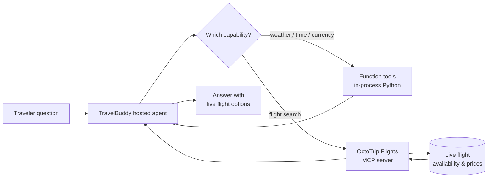

# Step 3 — Plug in an MCP server for live flight search

> **Goal:** wire the **OctoTrip Flights MCP** server into TravelBuddy so it can search real flights from a public, anonymous knowledge source — while keeping the Step 2 function tools.

## What you'll learn

- What the **Model Context Protocol (MCP)** is and why hosted agents can talk to MCP servers natively
- The difference between **function tools** (Step 2, local Python) and **MCP tools** (this step, a remote standardised server) — and why they coexist in the same agent
- How to register a remote MCP server in code with `client.get_mcp_tool(...)` and what `approval_mode` controls
- How `azure.yaml` passes the MCP server's configuration to the hosted agent through environment variables
- Why adding an MCP tool changes your code and config but **not** your deployment shape (no new Azure resources, no `azd provision`)

## What's already in the repo

- `travel_assistant/main.py`, `travel_assistant/tools.py`, and the repo-root `azure.yaml` — carried over from Step 2 (your TravelBuddy agent with the three function tools). Nothing was deleted when you advanced; your Step 2 work is preserved.
- The MCP settings are already listed in `.env.example` (`MCP_SERVER_LABEL`, `MCP_SERVER_URL`); this step starts using them.

In this step you make **delta-only** edits: add the MCP env vars to `.env`, add one line to `main.py` to register the MCP tool, append one sentence to TravelBuddy's instructions, and update `azure.yaml` (metadata plus two `env` entries). You do **not** rewrite `main.py`, `tools.py`, or `azure.yaml` from scratch — you add to the files you finished in Step 2.

## Concept (5-min read)

TravelBuddy already has three **function tools** (weather, local time, currency) — small Python functions that run **in-process** inside its container. That pattern is perfect for capabilities you own and can code. But some capabilities are better consumed as a **service**: a large, live data source (say, real-time flight availability) you don't want to re-implement or redeploy every time it changes. That's where MCP comes in.

The **Model Context Protocol (MCP)** is an open standard for connecting AI applications to external tools, data, and prompts. An **MCP server** exposes a set of capabilities (tools, resources, prompts) over a standard protocol; an **MCP client** (here, your hosted agent) connects to that server, discovers what it offers, and calls it when useful. Because the protocol is standardised, the same client can talk to *any* compliant server — GitHub, a database gateway, a docs service — without custom glue for each one.

The key contrast with Step 2:

| | Function tools (Step 2) | MCP tools (this step) |
| --- | --- | --- |
| Where the code runs | In-process, in your container | On a **remote** MCP server |
| Who owns it | You (your Python) | The server operator (here, OctoTrip) |
| How it's registered | Pass the function in `tools=[...]` | `client.get_mcp_tool(name=..., url=...)` |
| Tool schema | Inferred from type hints + docstring | Streamed from the server at connect time |
| Evolves without redeploy | No — you edit and redeploy | Yes — the server can add/update tools |

Crucially, **from the model's point of view they are all just tools.** The same tool-calling loop from Step 2 applies: the model sees the available tools (local *and* remote), decides which to call, the framework runs the call, and the result flows back into the answer. A single hosted agent can connect to many MCP servers at once, and the model picks the right capability per question.

This step points TravelBuddy at the **OctoTrip Flights MCP** server, a public, anonymous endpoint that searches live flights (routes, prices, times). Weather, time, and currency stay as local function tools (they're small and app-specific); flight search becomes an MCP tool because it's a large, live data source that OctoTrip keeps current for you.



`client.get_mcp_tool(...)` is the Agent Framework helper that turns a remote MCP server into a tool the agent can use. You give it a `name` (a stable label that identifies the server in logs and tool-call traces), a `url` (the MCP endpoint), and `approval_mode`. Setting `approval_mode="never_require"` lets the runtime call the server automatically without pausing for human approval — appropriate here because OctoTrip Flights is a read-only, public search source. For servers that mutate state (booking a flight, sending mail), you'd require approval instead.

The upstream `03-mcp` sample connects to the **GitHub** MCP server and passes an `Authorization` header built from a `GITHUB_PAT`. This workshop uses the exact same Agent Framework pattern but points at the **anonymous** OctoTrip Flights endpoint, so no token or header is needed. (The Troubleshooting section shows the authenticated variant if you switch to a server that requires a token.)

Helpful references:

- [What is the Model Context Protocol (MCP)?](https://modelcontextprotocol.io/) — the open standard TravelBuddy speaks to.
- [OctoTrip Flights MCP server](https://mcp.octotrip.app/flights) — the public, anonymous flight-search server used in this step (streamable HTTP; a single `search` tool taking `origin`, `destination`, and `departure_date`).
- [Model Context Protocol tools in Microsoft Foundry Agents](https://learn.microsoft.com/azure/foundry/agents/how-to/tools/model-context-protocol) — how Foundry agents connect to MCP servers and what `approval_mode` controls.
- [Using tools with an agent](https://learn.microsoft.com/agent-framework/agents/tools/function-tools) — the shared tool-calling loop that function tools and MCP tools both flow through.
- [What are hosted agents?](https://learn.microsoft.com/azure/foundry/agents/concepts/hosted-agents) — the hosted boundary your agent (and its MCP connection) runs inside.
- [Upstream `03-mcp` hosted-agent sample](https://github.com/microsoft-foundry/foundry-samples/tree/main/samples/python/hosted-agents/agent-framework/responses/03-mcp) — the sample this step is based on.

## Steps

### 1. Add the MCP env vars to `.env`

Open `.env` and add the MCP settings. They're already listed in `.env.example`; this step starts using them.

```env
# .env
MCP_SERVER_LABEL=octotrip-flights
MCP_SERVER_URL=https://mcp.octotrip.app/flights/mcp
```

- **`MCP_SERVER_LABEL`** is a short, stable identifier for the server. It becomes the tool group name that shows up in logs and tool-call traces, so keep it predictable and avoid spaces.
- **`MCP_SERVER_URL`** is the MCP endpoint the agent connects to.

Keep the Foundry values (`AZURE_AI_PROJECT_ENDPOINT`, `AZURE_AI_MODEL_DEPLOYMENT_NAME`, `WORKSHOP_RESOURCE_PREFIX`) in `.env` too. Don't add any secret for OctoTrip Flights MCP — it's public and anonymous.

### 2. Register the MCP tool in `travel_assistant/main.py`

Your `main.py` is already complete from Step 2 — **don't rewrite it.** There's exactly **one functional addition**: append a `client.get_mcp_tool(...)` entry to the existing `tools=[...]` list. Then add one sentence to the instructions so the model knows when to reach for flight search.

**Keep your Step 2 imports and function tools exactly as they are.** The three function tools are still registered; you're *adding* a fourth, remote tool alongside them:

```python
    tools = [
        get_weather,        # <-- kept from Step 2
        get_local_time,     # <-- kept from Step 2
        convert_currency,   # <-- kept from Step 2
        client.get_mcp_tool(                          # <-- add this entry
            name=os.environ["MCP_SERVER_LABEL"],
            url=os.environ["MCP_SERVER_URL"],
            approval_mode="never_require",
        ),
    ]
```

Then **keep your Step 2 instructions exactly as they are** and append one MCP sentence so the model knows the flight-search capability exists:

```python
        instructions=(
            # ... keep your Step 2 instructions here, unchanged ...
            "Use the OctoTrip Flights MCP server when the traveler asks about "
            "flights, routes, fares, or schedules; pass IATA airport codes and a "
            "departure date (YYYY-MM-DD) — if the traveler doesn't give one, call "
            "get_local_time and use the date part of its iso_time as today's date — "
            "and summarize the options you find."
        ),
        tools=tools,        # <-- the list you just extended above
```

That's the whole code change. `client.get_mcp_tool(...)` reads the label and URL from the environment (the same values you just added to `.env`) and hands the agent a remote tool. Everything else in `main.py` — the `FoundryChatClient` setup, the three function tools, `default_options={"store": False}`, and `ResponsesHostServer(agent).run()` — is unchanged from Step 2. If you get stuck, the finished file is in [`.workshop/solutions/03-mcp/`](.workshop/solutions/03-mcp/).

> **Why `os.environ[...]` and not a hardcoded URL?** Reading the label and URL from the environment keeps them out of source control and lets you point at a different MCP server (or the authenticated variant in Troubleshooting) by editing `.env` — no code change. The hosted runtime gets the same values through the `env` map in `azure.yaml`, resolved from your azd environment.

### 3. Update the agent's metadata and `env` in `azure.yaml`

An MCP connection is made **in code** and configured through **environment variables**, so the hosted-agent shape barely changes — same container, same `protocols`, and no new Azure resource, because the connection is just an outbound HTTPS call from the running container. This step makes two kinds of edit to the `travel-buddy` service in the repo-root `azure.yaml`: **metadata** (update the human-facing `description` and add an `MCP Tools` tag) and **configuration** (add the two MCP variables to the `env` map so both the local run and the deployed agent receive them):

```yaml
# azure.yaml — under services: travel-buddy:
    description: TravelBuddy with local function tools plus the OctoTrip Flights MCP server for live flight search.
    metadata:
      tags:
        - Agent Framework
        - AI Agent Hosting
        - Azure AI AgentServer
        - Responses Protocol
        - Travel Assistant
        - Function Tools
        - MCP Tools           # <-- added
    # ... protocols unchanged ...
    env:
      PYTHONNOUSERSITE: "1"
      AZURE_AI_PROJECT_ENDPOINT: ${FOUNDRY_PROJECT_ENDPOINT}
      AZURE_AI_MODEL_DEPLOYMENT_NAME: ${AZURE_AI_MODEL_DEPLOYMENT_NAME}
      WORKSHOP_RESOURCE_PREFIX: ${WORKSHOP_RESOURCE_PREFIX}
      MCP_SERVER_LABEL: ${MCP_SERVER_LABEL}   # <-- added
      MCP_SERVER_URL: ${MCP_SERVER_URL}       # <-- added
```

Each `${VAR}` is resolved from your **azd environment** (`.azure/<env-name>/.env`), not from the repo `.env` — you'll copy the two new values across in the next section. The MCP tools themselves are still connected in code via `client.get_mcp_tool(...)`, and the MCP server decides which concrete tools it exposes at connect time — `azure.yaml` describes how the agent is hosted, not what it can do. Leave the rest of the file (`name`, `container`, …) exactly as it was in Step 2.

## Run and deploy TravelBuddy

**Your code changes need no extra setup.** `azd` packages `travel_assistant/` straight from your working tree on every `azd ai agent run` and `azd deploy`, so your `main.py` changes are picked up automatically. You do **not** need `azd provision` again either — you added no new Azure resources, so the infrastructure from earlier steps is unchanged. The only new setup is copying the two MCP values into the azd environment. Run every command from the **repo root**.

1. **Add the new MCP values to the azd env.** azd keeps its **own** environment store (`.azure/<env-name>/.env`), separate from the repo `.env`. The Foundry values are already in the azd env from Step 1, so you only need to set the **two new** MCP variables. Load your `.env` into the shell first (the repo `.env` isn't auto-loaded), then pass the values through:

   <!-- terminal -->
   ```bash
   # bash / zsh
   set -a; source .env; set +a
   azd env set MCP_SERVER_LABEL "$MCP_SERVER_LABEL"
   azd env set MCP_SERVER_URL "$MCP_SERVER_URL"
   ```

   <!-- terminal -->
   ```powershell
   # PowerShell
   Get-Content .env | Where-Object { $_ -match '^\s*[^#].*=' } | ForEach-Object {
     $name, $value = $_ -split '=', 2
     Set-Item "Env:$($name.Trim())" $value.Trim()
   }
   azd env set MCP_SERVER_LABEL "$env:MCP_SERVER_LABEL"
   azd env set MCP_SERVER_URL "$env:MCP_SERVER_URL"
   ```

2. **Run TravelBuddy locally** in the hosted Responses runtime:

   <!-- terminal -->
   ```bash
   azd ai agent run
   ```

   `azd` reads the `travel-buddy` service in `azure.yaml`, resolves its `env` from your azd environment, and starts the server on `http://localhost:8088` — now with your three function tools **and** the OctoTrip Flights MCP connection loaded. Leave this terminal running.

3. **Invoke the local agent from a second terminal.** The `azd ai agent run` process is still holding the first terminal, so open a **new** one (also at the repo root) and ask a question that forces a flight search:

   <!-- terminal -->
   ```bash
   azd ai agent invoke --local "Find flights from Seattle (SEA) to Tokyo (NRT). List a few options with airline, price, and times."
   ```

   Expected: TravelBuddy calls the OctoTrip Flights MCP server and answers with real flight options — not just generic advice. The exact flights and prices change as the live server updates.

   Prefer a UI? With the local agent still running, open the **Agent Inspector** from the Foundry Toolkit (Command Palette → **Foundry Toolkit: Open Agent Inspector**). It connects to `http://localhost:8088` and shows each streamed MCP tool call and result.

4. **Deploy to Foundry**:

   <!-- terminal -->
   ```bash
   azd deploy
   ```

   `azd` uploads `travel_assistant/` as source — now including the MCP tool registration — and Foundry installs dependencies from `requirements.txt` using `remote_build` before rolling out a new hosted agent version with the two MCP env vars from `azure.yaml`. No container registry or `azd provision` is needed.

5. **Invoke the deployed agent**:

   <!-- terminal -->
   ```bash
   azd ai agent invoke "Find flights from Seattle (SEA) to Tokyo (NRT)."
   ```

   Prefer a UI? Open the **Hosted Agent Playground** from the Foundry Toolkit (**Developer Tools** → **Build** → **Hosted Agent Playground**), pick your deployed agent and version, and watch the MCP tool calls in the session details.

## Try it

Try prompts that make the tool choice obvious.

- "Find me flights from London (LHR) to New York (JFK)."

Now try a **mixed** prompt that should use both a local function tool and MCP in one conversation:

- "What's the weather in Reykjavik right now, and can you find flights from Reykjavik (KEF) to Copenhagen (CPH)?"

The weather portion should use the Step 2 `get_weather` function tool; the flight portion should use OctoTrip Flights MCP. That's the key lesson: local function tools and remote MCP tools are both just tools from the model's point of view, and it routes each part of the question to the right one.

## Troubleshooting

### MCP server unreachable

Check the URL in `.env`.

```env
# .env
MCP_SERVER_URL=https://mcp.octotrip.app/flights/mcp
```

The OctoTrip Flights MCP is public and anonymous, but it's rate-limited (roughly one request per second). If calls fail intermittently, space out your prompts and retry. If the endpoint is temporarily unavailable, try again later — or switch to the mock below.

### Use the mock when OctoTrip is unavailable

This repo ships a stand-in that speaks the same MCP protocol and exposes the same `search` tool, but **generates every offer from your request** instead of calling a live service: [`.workshop/mocks/octotrip_flights_mcp/`](.workshop/mocks/octotrip_flights_mcp/). Real airport coordinates give it believable durations, connections, and local arrival times, and the same request always returns the same offers — handy for a demo. Nothing it returns is real: the airlines are invented and every payload is marked `"mock": true`.

Run it locally with no dependencies:

```bash
make mock-mcp   # or: python .workshop/mocks/octotrip_flights_mcp/serve_local.py
```

That's enough for any MCP client on your machine, but **not** for your agent: `client.get_mcp_tool(...)` registers a *hosted* MCP tool, so Foundry calls the URL from its own network and never reaches your `localhost`. Give it a public URL instead.

The quick way, and the usual inner-loop pattern — keep the server local, tunnel it out with the [dev tunnel CLI](https://learn.microsoft.com/azure/developer/dev-tunnels/get-started):

```bash
devtunnel user login
devtunnel host --port-number 8931 --allow-anonymous
```

`--allow-anonymous` is required — Foundry sends no tunnel token, and a protected tunnel just answers 401. Don't name the tunnel: `devtunnel create <id>` needs a **globally unique** ID, so a shared name fails for everyone after the first person. `devtunnel host` prints the public URL; keep it running while you work. In a Codespace, forwarding port 8931 as **Public** does the same job.

For something that outlives your terminal, deploy it: the same folder is an Azure Functions app with anonymous access, and its [README](.workshop/mocks/octotrip_flights_mcp/README.md) has the `az` commands.

Either way, append `/mcp` to the URL. Only `MCP_SERVER_URL` changes — leave `MCP_SERVER_LABEL` alone — and set it in both places, `.env` and the azd environment:

```env
# .env
MCP_SERVER_URL=https://<generated-id>-8931.<region>.devtunnels.ms/mcp
```

<!-- terminal -->
```bash
# from the repo root
azd env set MCP_SERVER_URL "$MCP_SERVER_URL"
```

Skipping the `azd env set` is the usual reason the agent keeps calling the real server: `azd` reads its own environment, not the repo's `.env`. Restart `azd ai agent run` afterwards. A temporary tunnel gets a new URL each time you host it, so redo that command whenever you restart it.

> **`--allow-anonymous` is safe for this mock only.** It publishes an endpoint that authenticates nobody, which is fine here because the mock holds no data, has no managed identity, and invents every answer — there is nothing for a stranger to read or borrow. Don't reuse the flag for a server that fronts real data. In [Step 5](.workshop/docs/steps/05-rag.md) your Search MCP holds `Search Index Data Reader` over your destinations index; exposing *that* anonymously would publish read access to every document in it, to anyone with the URL, with no sign-in and no audit trail. A retrieval endpoint authenticates its callers with Entra ID — tunnelled or deployed.

Switch back to `https://mcp.octotrip.app/flights/mcp` once the real server answers again.

### No MCP tools listed

Confirm the two settings are in `.env`, in the azd environment (`azd env get-values`), and in the `env` map of the `travel-buddy` service in `azure.yaml`, and that `main.py` actually appends `client.get_mcp_tool(...)` to the `tools` list passed to `Agent`.

Common mistakes:

- adding the `env` entries under the `ai-project` service instead of `travel-buddy`;
- adding `MCP_SERVER_LABEL` / `MCP_SERVER_URL` to `.env` but not running `azd env set` for them (azd never reads the repo `.env`);
- adding them to the azd environment but not to the `env` map in `azure.yaml`;
- forgetting to restart `azd ai agent run` (or redeploy) after changing the values.

### The local function tools stopped working

The final `tools` list should contain **four** entries: the three function tools from Step 2 (`get_weather`, `get_local_time`, `convert_currency`) plus the MCP tool from this step. If you replaced the whole list with only the MCP tool, restore the function tools and run again.

### Auth error against the MCP server

OctoTrip Flights MCP is anonymous, so an auth error usually means you changed `MCP_SERVER_URL` to a server that requires a token. For an authenticated MCP server, follow the upstream `03-mcp` auth pattern: read a token from the environment and pass an `Authorization` header to `client.get_mcp_tool(...)`.

```python
# travel_assistant/main.py
token = os.environ["MCP_SERVER_TOKEN"]
mcp_tool = client.get_mcp_tool(
    name=os.environ["MCP_SERVER_LABEL"],
    url=os.environ["MCP_SERVER_URL"],
    headers={"Authorization": f"Bearer {token}"},
    approval_mode="never_require",
)
```

Do not commit tokens to `.env.example`, `azure.yaml`, or source control. Use your local `.env` or the deployment environment's secret store.

### The agent answers without searching flights

Make the prompt explicit: give an origin, a destination (IATA codes work well), and a departure date, and ask for flight options. MCP gives the model access to live flight search, but the model still chooses whether to call it. Strong prompts make the desired tool use clear while you're testing.

### Deploy didn't pick up my MCP change

Make sure you ran `azd env set` for `MCP_SERVER_LABEL` and `MCP_SERVER_URL` (step 1 above), that both have an entry in the `env` map of the `travel-buddy` service in `azure.yaml`, and then run `azd deploy` again from the repo root (where `azure.yaml` lives).

## Solution

> If you get stuck: [`.workshop/solutions/03-mcp/`](.workshop/solutions/03-mcp/)

## Upstream sample

> Based on the upstream [`03-mcp`](https://github.com/microsoft-foundry/foundry-samples/tree/main/samples/python/hosted-agents/agent-framework/responses/03-mcp) sample.
